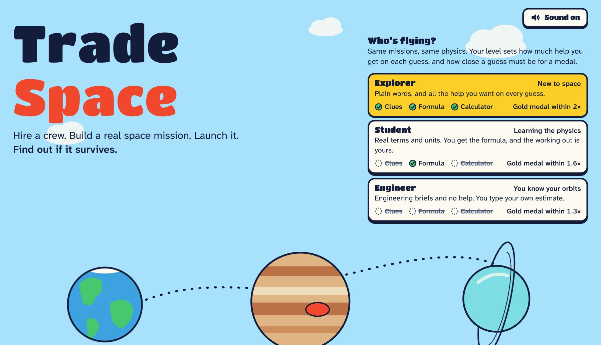
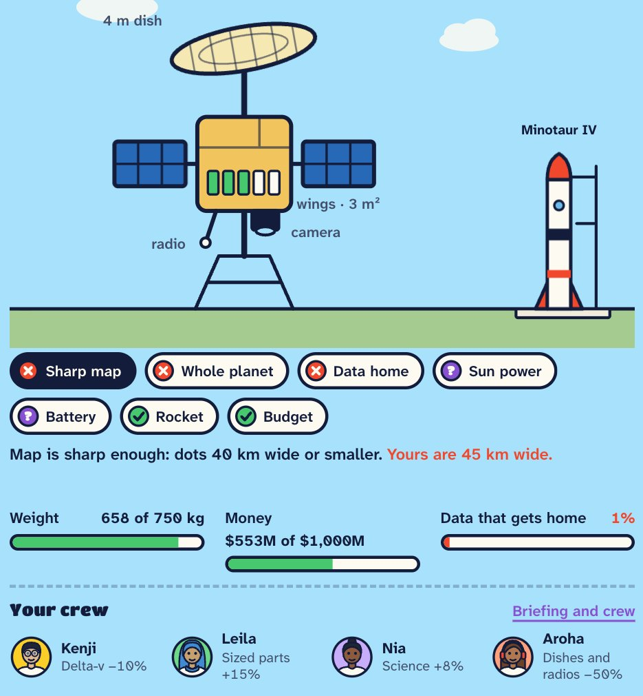

# Trade Space

**Design a real space mission, launch it, and find out if it survives.**

Trade Space is a browser game where every number is real physics. Before the game shows you a
number (how long one orbit takes, how big the battery must be, how fast the radio can send data),
you estimate it yourself. Then you fly the mission through real history and see what your choices
cost.

**[Play it](https://trade-space-one.vercel.app)** · **[7-slide demo](https://trade-space-one.vercel.app/demo/)**

Built by Team Rising Crest for the NASA Space Apps Challenge 2026, challenge *Space Mission Design
Game*.



## How a mission goes

1. **Read the briefing.** Where the spacecraft goes, why it is worth flying, what counts as
   success and what makes it hard.
2. **Hire a crew.** Four department heads, three candidates for each seat. Every candidate brings
   one edge (a cheaper launch, lighter instruments, extra margin on the parts you size). Edges
   change prices, masses and margins. They never change the physics.
3. **Build it, one decision at a time.** Orbit, instruments, power, radio, trajectory, rocket. A
   live budget shows mass, cost and data, and a row of lights shows which goals you meet.
4. **Guess before you look.** Numbers stay hidden until you estimate them on a logarithmic slider.
   You get a medal for how close you were, then a card explains the answer with your own numbers.
5. **Size the power system yourself.** The solar array and battery are built to your estimate. You
   only find out in flight whether they were big enough.
6. **Launch and fly.** The mission plays out on a timeline, with real events where history has them.
7. **Read the report.** Your design next to NASA's, and a chart of every design you could have
   built.



## The three missions

| Mission | What you wrestle with | What is real |
|---|---|---|
| **SMAP (2015)**, the tutorial | Low Earth orbit: eclipse and battery sizing, map sharpness against coverage, getting the data home | The 26 geomagnetic storms of 2015 from NASA DONKI, and SMAP's radar failure on 7 July 2015 |
| **Juno (2011)** | Solar power where sunlight is 27 times weaker, an Earth flyby against a direct launch, radiation, an X-band link budget | Juno's own history: the Earth flyby, Jupiter arrival, the 2016 valve problem, the 2019 eclipse-dodging burn |
| **Uranus Orbiter & Probe (future)** | Choosing a launch year, nuclear power that fades over 13 years or more, a link across 19 AU, the probe, aerocapture risk | Launch windows from real Jupiter and Uranus positions (JPL Horizons). NASA has not flown this one |

## Three levels, one set of physics

The missions and the numbers are identical at every level. What changes is how much help you get
on each estimate, which words are used, and how close a guess must be for a medal.

| Level | For | Clues | Formula | Calculator | Gold medal |
|---|---|---|---|---|---|
| **Explorer** | New to space | Yes | Yes | Yes, it can fill in the formula for you | Within 2× |
| **Student** | Learning the physics | No | Yes, with your design's values | No | Within 1.6× |
| **Engineer** | You know your orbits | No | No | No | Within 1.3× |

A guess is graded at the level it was made at, and stars are kept separately for each level.

## Every design you could have built

After each flight the game searches every possible design (about 16,000 for SMAP, 3,000 for Juno
and 27,000 for Uranus) and plots cost against science. The best designs form a line engineers call
the Pareto frontier: nothing gets more science for the same money. The chart shows where your
design sits, and whether a cheaper one would have done as well.

## Is the physics right?

The models are standard and unit-tested: Kepler's third law, a cylindrical-shadow eclipse model,
the diffraction limit, the rocket equation, the inverse-square law, a free-space link budget and
Hohmann transfers.

Checks against real spacecraft, in this model:

| | The game gives | Real |
|---|---|---|
| SMAP launch mass, with NASA's choices | 867 kg | 944 kg |
| Juno power at Jupiter | 582 W | about 500 W |
| Juno launch mass | 3,432 kg | 3,625 kg |

For Uranus, the search on its own lands on NASA's concept study: a 2031 launch, a Jupiter gravity
assist, three RTGs, a probe and a Falcon Heavy.

**What is simplified.** Rocket capacities and prices, subsystem masses, powers, data volumes and
budgets are approximate game values, not sourced figures. The twelve crew members are fictional
and so are their edges. [VERIFY.md](VERIFY.md) lists every fact the game presents as real, so each
one can be checked, and separates them from the game values.

## Real data in the game

Shipped in [`src/data`](src/data):

- **NASA DONKI** geomagnetic storms for 2015
  ([`scripts/fetch-donki.mjs`](scripts/fetch-donki.mjs) downloads them)
- **JPL Horizons** positions of Jupiter and Uranus, 2026 to 2064, used for the Uranus launch windows
- **JPL Horizons** range to Voyager 1, used for the live light-time line on the title screen

## Run it yourself

You need Node.js. It was built and tested on Node 22.

```bash
npm install
npm run dev
```

Other commands:

```bash
npx vitest run    # the tests: physics, missions, formulas, crew and levels
npm run build     # type-check and build into dist/
npm run lint      # oxlint
```

There is no backend, no account and nothing to configure. The game stores your level, crew and
stars in the browser's local storage.

## How the code is laid out

```
src/
  physics/     shared models: orbits, eclipse, power, link budget, transfers
  game/        the mission contract, levels, crew, medals, stars, the formula calculator
  missions/    smap/, juno/, uranus/: each has its model, estimates, flight, controls and art
  ui/          the screens (title, briefing, build, flight, report) and shared parts
  data/        the NASA and JPL data files
public/demo/   the 7-slide demo deck, plain HTML
docs/          the Space Apps submission text
scripts/       the DONKI download script
```

A mission is one object that implements the contract in
[`src/game/types.ts`](src/game/types.ts): its physics, its build steps, the numbers the player
estimates (each with a question, clues, a formula and an explanation), its flight timeline and
NASA's real design to compare against. The screens are generic, so adding a mission means writing
a new folder under `src/missions/`.

Built with TypeScript, React 19, Vite, Tailwind CSS and Vitest.

## Use of AI

An AI coding assistant (Claude) helped write and refactor the code, look up mission facts and
draft explanatory text. It also produced the demo slides. ChatGPT generated the team image. The
physics models are checked by unit tests against known values, and the facts shown as real are
listed in [VERIFY.md](VERIFY.md) for the team to check.

## Licence

The code is released under the [MIT License](LICENSE). The data files in [`src/data`](src/data)
come from NASA and JPL, as listed above.

## Sources

- [NASA DONKI](https://ccmc.gsfc.nasa.gov/tools/DONKI/) · [JPL Horizons](https://ssd.jpl.nasa.gov/horizons/) · [api.nasa.gov](https://api.nasa.gov/)
- NASA/JPL mission pages for [SMAP](https://smap.jpl.nasa.gov/) and [Juno](https://science.nasa.gov/mission/juno/)
- [NASA Uranus Orbiter and Probe concept study](https://science.nasa.gov/wp-content/uploads/2023/11/uranus-orbiter-and-probe-uop.pdf)
- Planetary Science and Astrobiology Decadal Survey 2023–2032 (National Academies)
- Wertz & Larson, *Space Mission Analysis and Design*; Vallado, *Fundamentals of Astrodynamics and Applications*
- Fonts: Titan One and Atkinson Hyperlegible Next (Google Fonts, SIL Open Font License)
